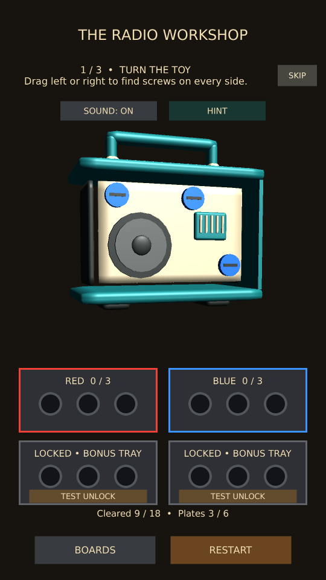
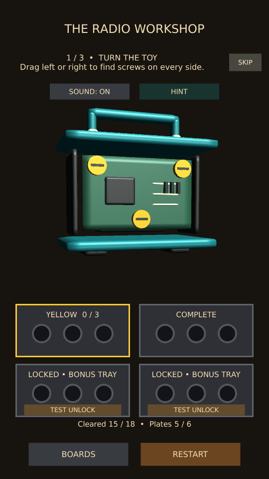

# Radio disassembly refinement

The radio now comes apart as recognizable assemblies:

1. The teal front shell carries its cream grille, tuning window and knobs.
2. Behind it sits a cream speaker baffle with a dark speaker cone, dust cap,
   tuning housing and coil. Its three blue screws release the whole assembly.
3. A green circuit board with a receiver chip, traces and capacitors is held by
   three yellow screws. These remain inaccessible until the speaker assembly finishes releasing.
4. Behind the board is a battery cradle inside a hollow frame with side rails.

The outer rear and side panels remain removable. There are now 18 screws and six
plates. The Radio uses the R/B/Y/R/B/Y tray sequence and can still be solved with two
free trays. The Car retains its own 15-screw sequence; the Robot retains its existing
18-screw sequence. Save signatures reject unfinished Radio runs from the older layout;
completed-board badges remain intact. Restart restores all shells, assemblies and parts.

This is the first board-quality pass for the Toy Shop theme. Additional themes,
new boards, ads and purchased credit packs are deferred. The existing Hint is still
an unmonetized test feature; its intended release model remains one rewarded ad per
hint or purchased credits usable for hints and bonus trays.

## PC and phone acceptance

- Rotate the intact radio and confirm outer screws remain easy to select.
- Remove the front shell: grille, display and knobs should leave together, revealing
  the speaker cone and tuning mechanism rather than a flat placeholder panel.
- Remove the three blue screws: speaker components should leave together and reveal
  the circuit board. Its yellow screws must remain blocked during speaker release.
- Remove the circuit board: its chip, traces and capacitors should move with it,
  exposing the battery cradle and hollow frame.
- Solve with the two free trays; the celebration should wait for all six plates.
- Restart during each layer's release, resume a partly dismantled radio, and use hints.
- Repeat in a fresh Workshop Android build and inspect the layers from all sides.

Manual acceptance pending. Changes remain local.

## Automated validation

All 12 selected Unity tests passed: radio interaction/disassembly, hints across all
three boards, completion, resume and tutorial behavior. A separate capture test
passed; both interior stages were reviewed at 540x960 and 1000x700. No manual PC
or Android acceptance is implied by these automated checks.

