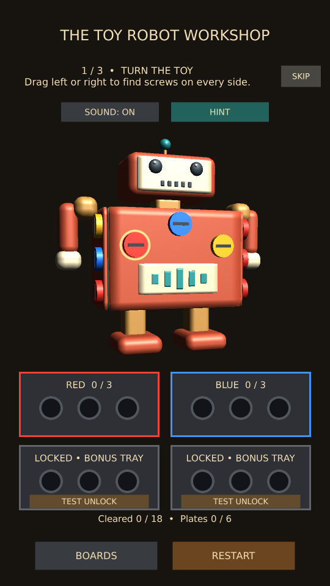

# Workshop hints

HINT sits beside Sound on all three boards. It finds an unremoved, accessible screw
that matches an open tray with space. Visible matches are preferred; otherwise the
toy turns horizontally to a face where the candidate can actually be selected.
A pale pulsing ring and a color-name instruction identify the screw for five seconds.
The player still taps to remove it. The ring does not receive pointer input.

Hints are free and unlimited in this prototype. They do not collect screws, unlock
trays, change completion or save a move. Locked deeper layers are excluded. During
screw/plate animation and after winning, the button is disabled. Moving the toy,
removing a screw or restarting clears the highlight. No-target feedback is shown
if no selectable matching screw is found; the original rotation is restored.

## PC and phone checks

- Tap HINT from the front, back and sides of every toy; check the ring points to a
  screw matching an open tray and that it can be tapped normally.
- Use hints to reach the robot's brass and core layers. Covered screws must never
  be highlighted before the covering plate finishes releasing.
- Drag after a hint, wait five seconds, and Restart: each should clear the ring.
- Tap repeatedly and during animations; no screws should disappear without a tap.
- Confirm saved progress and tray counts are unchanged by a hint alone.
- Repeat in a new Workshop Android build. Review ring visibility and button reach.

Manual acceptance is pending. Changes are local and have not been pushed.

Validation: nine selected project tests passed, plus a portrait/wide render helper. The new test solves all three boards using only hints and actual highlighted-screw taps, verifies locked layers are excluded, confirms no hint-only changes to saved actions or removed counts, and checks busy/won/Restart behavior. Existing radio interaction, resume and tutorial tests also passed. Both layouts were visually inspected. Device acceptance is pending.

